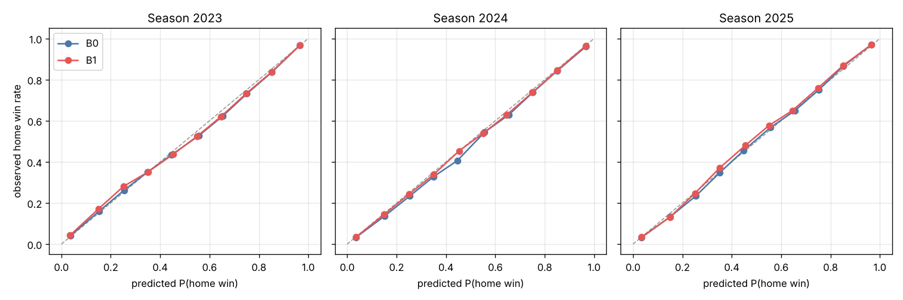

# B0·B1 승리확률 기준선 리포트

> 자동 생성: `PYTHONPATH=src python -m wp.report` (입력: `reports/results.json`). 수치는 모두 실제 실행 측정값이다.

## 1. 요약

- 평가 시즌 2023, 2024, 2025 (워크포워드), 평가 상태 548,277개 / 7,253경기.
- **B1 대 B0**: 3시즌 합산 로그 손실 차이 B1−B0 = -0.0043 [-0.0064, -0.0021] (합산 표본을 경기 단위로 1,000회 재표집한 95% CI) → CI가 0보다 완전히 아래이므로 **B1이 B0보다 낫다**.
- 층별 B1−B0: 접전 -0.0058 [-0.0088, -0.0027], 7회 이후 -0.0009 [-0.0023, 0.0006], 7회 이후 접전 -0.0018 [-0.0042, 0.0009]. 개선은 경기 초·중반에 크고 후반으로 갈수록 작아진다 — 후반에는 점수·아웃 상태가 대부분의 정보를 갖기 때문이다 (7회 이후 접전은 CI가 0을 포함).
- B1 계수 `d`가 모든 평가 시즌에서 음수(-0.61, -0.66, -0.61) → 진행도가 커질수록 Elo의 영향이 줄어든다. `c`≈1.16>1은 Elo 확률이 실제보다 0.5 쪽으로 눌려 있어 B1이 경기 전 전력차를 조금 늘려 쓴다는 뜻이다.
- 학습 데이터를 1908년까지 최대로 쓴 B0가 최근 30시즌만 쓴 B0보다 약간 낫다(§6).

## 2. 데이터

- **출처**: Retrosheet 이벤트 파일·게임로그. retrosheet.org는 작업 환경에서 접속이 차단되어, Chadwick Baseball Bureau가 관리하는 GitHub 미러 `chadwickbureau/retrosheet`(master 브랜치)에서 받았다. 상세는 `docs/DATA_SOURCES.md`.
- **파싱**: Retrosheet가 제공하는 파싱된 CSV는 사이트 차단으로 확인하지 못했고, Chadwick(C) 빌드는 환경 정책상 외부 코드 컴파일이 막혀 사용하지 못했다. 그래서 이벤트 파일 문법(retrosheet.org/eventfile.htm)을 따라 순수 파이썬 파서(`src/wp/retro_parse.py`)를 작성했고, **모든 경기의 파싱 최종 점수를 게임로그와 대조**해 검증했다.
- 다운로드: 1901–2025 게임로그, 이벤트 파일 1908–2025 (1901–1907은 플레이 기록 없음, 게임로그만 Elo 워밍업에 사용). 원본 1,086 MB, 다운로드 60.1 초.
- 이벤트 파일 경기 199,897개, 타석 시작 상태 15,354,641개, 파싱+가공 103.6 초 (4코어).
- 분석 포함 경기 196,411개, 포함 상태 15,114,465개.

### 제외 경기

| 사유 | 경기 수 |
|---|---:|
| 무승부·조기 종료(콜드 등, 9이닝 미완료) | 2,019 |
| 2020 단축 시즌 | 898 |
| 서스펜디드(후일 재개 완료) | 191 |
| 7이닝 더블헤더 (2021; 2020분은 시즌 제외에 포함) | 123 |
| 0절 검증: 투구 시퀀스 위반 | 112 |
| 0절 검증: 타순 연속성 끊김 | 73 |
| 몰수 경기 | 22 |
| 정규시즌 외(순위결정전 등) | 22 |
| 홈팀 선공 경기 | 21 |
| 0절 검증: 3아웃 위반 | 2 |
| 0절 검증: 잔루 불일치 | 2 |
| 파서 오류 | 1 |
| **합계** | **3,486** |

사유는 하나만 붙인다(예: 2020년 7이닝 더블헤더는 '2020 단축 시즌'으로 집계). 0절 검증 사유(라인스코어·3아웃·잔루·타순 연속성·투구 시퀀스)는 `src/wp/validate.py`가 기존 사유가 없는 경기에만 붙인다. 이전 버전의 '파싱 점수 ≠ 게임로그' 216경기는 `rX#(fielders)(E…)` 표기 해석을 고친 뒤 모두 일치하게 되어 사라졌다(상세는 `reports/b2_report.md` 0절).

## 3. 설계

**상태 키** (`src/wp/states.py`): 이닝(1–9, 10+), 초/말, 아웃(0–2), 주자(3비트), 점수차(홈−원정, ±10 절단), 연장 규칙 시대 `xrule`(10+ 이닝에서만). 총 키 공간 11,088칸, 그중 가능한 상태 10,368칸.

**연장 처리 — 규칙 시대별 분리 집계.** 이벤트 파일의 `info,tiebreaker,2`(연장 2루 주자) 필드가 2020–2025 모든 경기에 있고 2019년 이전에는 없음을 데이터로 확인했다. 10+ 이닝 칸만 `xrule`로 나누고 정규 이닝은 전 시대를 공유한다. 따라서 2023 평가 모델의 연장 칸(xrule=1)은 2021–2022 시즌만으로 학습되며(2020 제외), 표본이 적은 만큼 아래의 축소가 같은 시대의 더 거친 칸(이닝·점수차)으로 끌어당긴다. 이유: 시대 분리는 2루 주자 규칙의 큰 효과를 정확히 반영하면서 정규 이닝의 방대한 과거 표본을 버리지 않는다.

**평활 — 계층적 베이지안 축소.** `wp_L = (승_L + k·wp_부모)/(n_L + k)`를 거친 단계부터 적용: (초/말) → (이닝, 초/말, 점수차 구간) → (…, 점수차) → (…, 아웃, 주자 수, 점수차) → 전체 상태. 표본이 많은 칸은 경험 비율을 유지하고, 적은 칸은 주자 상태 단순화·점수차 구간 확대 쪽으로 백오프된다. `k`는 평가 시즌 S에 대해 S−2 이전으로 학습하고 S−1에서 로그 손실로 선택(그리드 1–1000). 테이블에 칸별 `n`, `wins`, 원 비율 `p_raw`, 부모 단계의 `n_L0..L2`, `wp_L0..L2`를 함께 저장했다.

**Elo** (`src/wp/elo.py`): 게임로그 1901–2025 전 정규시즌 경기를 날짜·더블헤더 순서대로 갱신(경기 전 확률을 먼저 기록한 뒤 결과 반영), 홈 어드밴티지와 시즌 간 1500으로의 평균 회귀 포함, 연고 이전은 프랜차이즈로 연결. 하이퍼파라미터는 1993–2022 시즌 로그 손실로 선택(모든 평가 시즌 이전): K=4, HFA=24, 회귀=0.33.

**B1** (`src/wp/b1_model.py`): `logit(WP_B1) = a + b·logit(WP_B0) + c·logit(P_pre) + d·logit(P_pre)·진행도`, 진행도 = 1 − 남은 정규 아웃/54. 평가 시즌 S의 B1은 S 직전 5개 포함 시즌으로 학습하며, 학습 행의 WP_B0도 **그 행의 시즌 이전 데이터로만 만든 테이블**에서 가져온다(표본 내 B0 과적합이 계수 b를 부풀리는 것을 방지).

## 4. 시즌별 결과 (워크포워드)

### 평가 시즌 2023

- B0 학습 1908–2022, k=30; B1 학습 시즌 [2017, 2018, 2019, 2021, 2022]; 평가 상태 183,573 / 2,417경기 (연장 2루 주자 시대 상태 2,219).
- B1 계수: a=-0.163, b=1.005, c=1.218, d=-0.607 (1회초 Elo 가중 c=1.22 → 9회말 c+d=0.61).
- 경기 전 점검(1회초 시작 상태, 2417경기): |B1−Elo| 평균 0.0135, 최대 0.0401, 상관 0.99997; 평균 B1 0.541 vs Elo 0.533 (B0는 이 상태에서 0.541로 상수). 평균 1.4%p 차이로 크게 어긋나지 않으며, 차이는 주로 c>1에 따른 전력차 확대에서 온다.

**로그 손실** (추정 [95% CI], 경기 단위 블록 부트스트랩 1,000회)

| 층 | 상태 수 | 경기 수 | B0 | B1 | Elo만 | B1−B0 (95% CI) | P(B1<B0) |
|---|---:|---:|---|---|---|---|---:|
| all | 183,573 | 2,417 | 0.4784 [0.4654, 0.4912] | 0.4741 [0.4613, 0.4880] | 0.6832 [0.6769, 0.6893] | -0.0042 [-0.0078, -0.0007] | 0.987 |
| inning>=7 | 59,567 | 2,417 | 0.3039 [0.2866, 0.3228] | 0.3039 [0.2862, 0.3232] | 0.6872 [0.6811, 0.6932] | -0.0001 [-0.0026, 0.0022] | 0.531 |
| close(|diff|<=2) | 121,981 | 2,417 | 0.6094 [0.5997, 0.6197] | 0.6036 [0.5926, 0.6152] | 0.6858 [0.6798, 0.6922] | -0.0058 [-0.0107, -0.0011] | 0.988 |
| inning>=7 & close | 30,531 | 1,589 | 0.4982 [0.4762, 0.5212] | 0.4972 [0.4757, 0.5206] | 0.6948 [0.6871, 0.7028] | -0.0010 [-0.0056, 0.0031] | 0.683 |

**Brier score**

| 층 | 상태 수 | 경기 수 | B0 | B1 | Elo만 | B1−B0 (95% CI) | P(B1<B0) |
|---|---:|---:|---|---|---|---|---:|
| all | 183,573 | 2,417 | 0.1617 [0.1569, 0.1666] | 0.1598 [0.1549, 0.1652] | 0.2451 [0.2420, 0.2481] | -0.0019 [-0.0035, -0.0005] | 0.992 |
| inning>=7 | 59,567 | 2,417 | 0.0959 [0.0897, 0.1026] | 0.0957 [0.0896, 0.1028] | 0.2470 [0.2440, 0.2500] | -0.0002 [-0.0011, 0.0007] | 0.649 |
| close(|diff|<=2) | 121,981 | 2,417 | 0.2119 [0.2076, 0.2163] | 0.2091 [0.2043, 0.2141] | 0.2463 [0.2434, 0.2495] | -0.0028 [-0.0049, -0.0006] | 0.994 |
| inning>=7 & close | 30,531 | 1,589 | 0.1641 [0.1551, 0.1734] | 0.1637 [0.1551, 0.1729] | 0.2507 [0.2469, 0.2547] | -0.0004 [-0.0022, 0.0012] | 0.691 |

### 평가 시즌 2024

- B0 학습 1908–2023, k=30; B1 학습 시즌 [2018, 2019, 2021, 2022, 2023]; 평가 상태 182,151 / 2,418경기 (연장 2루 주자 시대 상태 2,425).
- B1 계수: a=-0.176, b=0.997, c=1.216, d=-0.656 (1회초 Elo 가중 c=1.22 → 9회말 c+d=0.56).
- 경기 전 점검(1회초 시작 상태, 2418경기): |B1−Elo| 평균 0.0118, 최대 0.0398, 상관 0.99996; 평균 B1 0.538 vs Elo 0.534 (B0는 이 상태에서 0.541로 상수). 평균 1.2%p 차이로 크게 어긋나지 않으며, 차이는 주로 c>1에 따른 전력차 확대에서 온다.

**로그 손실** (추정 [95% CI], 경기 단위 블록 부트스트랩 1,000회)

| 층 | 상태 수 | 경기 수 | B0 | B1 | Elo만 | B1−B0 (95% CI) | P(B1<B0) |
|---|---:|---:|---|---|---|---|---:|
| all | 182,151 | 2,418 | 0.4699 [0.4556, 0.4840] | 0.4646 [0.4503, 0.4786] | 0.6832 [0.6767, 0.6894] | -0.0053 [-0.0092, -0.0013] | 0.998 |
| inning>=7 | 59,197 | 2,418 | 0.3022 [0.2832, 0.3212] | 0.2996 [0.2801, 0.3185] | 0.6870 [0.6803, 0.6935] | -0.0026 [-0.0050, -0.0000] | 0.980 |
| close(|diff|<=2) | 120,915 | 2,418 | 0.6058 [0.5954, 0.6163] | 0.5992 [0.5876, 0.6104] | 0.6838 [0.6770, 0.6905] | -0.0067 [-0.0121, -0.0013] | 0.992 |
| inning>=7 & close | 29,836 | 1,574 | 0.5050 [0.4851, 0.5268] | 0.5013 [0.4808, 0.5233] | 0.6891 [0.6806, 0.6977] | -0.0037 [-0.0080, 0.0008] | 0.950 |

**Brier score**

| 층 | 상태 수 | 경기 수 | B0 | B1 | Elo만 | B1−B0 (95% CI) | P(B1<B0) |
|---|---:|---:|---|---|---|---|---:|
| all | 182,151 | 2,418 | 0.1578 [0.1524, 0.1630] | 0.1557 [0.1502, 0.1610] | 0.2451 [0.2419, 0.2481] | -0.0020 [-0.0037, -0.0004] | 0.990 |
| inning>=7 | 59,197 | 2,418 | 0.0951 [0.0885, 0.1019] | 0.0943 [0.0877, 0.1010] | 0.2470 [0.2437, 0.2501] | -0.0007 [-0.0016, 0.0001] | 0.941 |
| close(|diff|<=2) | 120,915 | 2,418 | 0.2100 [0.2055, 0.2145] | 0.2071 [0.2022, 0.2120] | 0.2454 [0.2421, 0.2487] | -0.0029 [-0.0052, -0.0005] | 0.989 |
| inning>=7 & close | 29,836 | 1,574 | 0.1669 [0.1588, 0.1758] | 0.1657 [0.1575, 0.1745] | 0.2480 [0.2438, 0.2522] | -0.0013 [-0.0030, 0.0005] | 0.922 |

### 평가 시즌 2025

- B0 학습 1908–2024, k=30; B1 학습 시즌 [2019, 2021, 2022, 2023, 2024]; 평가 상태 182,553 / 2,418경기 (연장 2루 주자 시대 상태 2,360).
- B1 계수: a=-0.180, b=0.995, c=1.163, d=-0.608 (1회초 Elo 가중 c=1.16 → 9회말 c+d=0.56).
- 경기 전 점검(1회초 시작 상태, 2418경기): |B1−Elo| 평균 0.0085, 최대 0.0293, 상관 0.99999; 평균 B1 0.535 vs Elo 0.534 (B0는 이 상태에서 0.540로 상수). 평균 0.9%p 차이로 크게 어긋나지 않으며, 차이는 주로 c>1에 따른 전력차 확대에서 온다.

**로그 손실** (추정 [95% CI], 경기 단위 블록 부트스트랩 1,000회)

| 층 | 상태 수 | 경기 수 | B0 | B1 | Elo만 | B1−B0 (95% CI) | P(B1<B0) |
|---|---:|---:|---|---|---|---|---:|
| all | 182,553 | 2,418 | 0.4633 [0.4514, 0.4748] | 0.4599 [0.4471, 0.4727] | 0.6810 [0.6749, 0.6872] | -0.0034 [-0.0072, 0.0001] | 0.972 |
| inning>=7 | 59,233 | 2,418 | 0.2876 [0.2703, 0.3049] | 0.2876 [0.2698, 0.3053] | 0.6850 [0.6790, 0.6913] | -0.0001 [-0.0025, 0.0024] | 0.510 |
| close(|diff|<=2) | 122,848 | 2,418 | 0.5975 [0.5881, 0.6067] | 0.5925 [0.5821, 0.6022] | 0.6824 [0.6758, 0.6889] | -0.0050 [-0.0100, -0.0004] | 0.984 |
| inning>=7 & close | 30,545 | 1,569 | 0.4780 [0.4576, 0.4988] | 0.4774 [0.4569, 0.4976] | 0.6878 [0.6797, 0.6960] | -0.0006 [-0.0051, 0.0039] | 0.615 |

**Brier score**

| 층 | 상태 수 | 경기 수 | B0 | B1 | Elo만 | B1−B0 (95% CI) | P(B1<B0) |
|---|---:|---:|---|---|---|---|---:|
| all | 182,553 | 2,418 | 0.1556 [0.1512, 0.1599] | 0.1540 [0.1493, 0.1587] | 0.2440 [0.2410, 0.2471] | -0.0016 [-0.0032, -0.0001] | 0.985 |
| inning>=7 | 59,233 | 2,418 | 0.0897 [0.0836, 0.0960] | 0.0896 [0.0834, 0.0960] | 0.2460 [0.2431, 0.2491] | -0.0001 [-0.0010, 0.0008] | 0.583 |
| close(|diff|<=2) | 122,848 | 2,418 | 0.2067 [0.2026, 0.2107] | 0.2044 [0.1999, 0.2087] | 0.2447 [0.2415, 0.2479] | -0.0023 [-0.0046, -0.0002] | 0.986 |
| inning>=7 & close | 30,545 | 1,569 | 0.1561 [0.1479, 0.1641] | 0.1559 [0.1477, 0.1638] | 0.2474 [0.2434, 0.2514] | -0.0003 [-0.0021, 0.0014] | 0.618 |

### 3시즌 합산

**로그 손실**

| 층 | 상태 수 | 경기 수 | B0 | B1 | Elo만 | B1−B0 (95% CI) | P(B1<B0) |
|---|---:|---:|---|---|---|---|---:|
| all | 548,277 | 7,253 | 0.4705 [0.4627, 0.4783] | 0.4663 [0.4583, 0.4745] | 0.6824 [0.6788, 0.6859] | -0.0043 [-0.0064, -0.0021] | 1.000 |
| inning>=7 | 177,997 | 7,253 | 0.2979 [0.2873, 0.3093] | 0.2970 [0.2859, 0.3083] | 0.6864 [0.6827, 0.6899] | -0.0009 [-0.0023, 0.0006] | 0.891 |
| close(|diff|<=2) | 365,744 | 7,253 | 0.6042 [0.5980, 0.6103] | 0.5984 [0.5918, 0.6054] | 0.6840 [0.6802, 0.6880] | -0.0058 [-0.0088, -0.0027] | 1.000 |
| inning>=7 & close | 90,912 | 4,732 | 0.4936 [0.4802, 0.5063] | 0.4919 [0.4783, 0.5051] | 0.6906 [0.6858, 0.6958] | -0.0018 [-0.0042, 0.0009] | 0.904 |

**Brier score**

| 층 | 상태 수 | 경기 수 | B0 | B1 | Elo만 | B1−B0 (95% CI) | P(B1<B0) |
|---|---:|---:|---|---|---|---|---:|
| all | 548,277 | 7,253 | 0.1584 [0.1555, 0.1614] | 0.1565 [0.1536, 0.1596] | 0.2447 [0.2430, 0.2464] | -0.0018 [-0.0027, -0.0009] | 1.000 |
| inning>=7 | 177,997 | 7,253 | 0.0936 [0.0899, 0.0975] | 0.0932 [0.0894, 0.0972] | 0.2467 [0.2448, 0.2484] | -0.0003 [-0.0008, 0.0002] | 0.888 |
| close(|diff|<=2) | 365,744 | 7,253 | 0.2095 [0.2068, 0.2121] | 0.2069 [0.2041, 0.2099] | 0.2455 [0.2436, 0.2474] | -0.0026 [-0.0039, -0.0013] | 1.000 |
| inning>=7 & close | 90,912 | 4,732 | 0.1624 [0.1570, 0.1673] | 0.1617 [0.1563, 0.1669] | 0.2487 [0.2464, 0.2512] | -0.0007 [-0.0016, 0.0004] | 0.895 |

`Elo만`은 경기 전 확률을 경기 내내 고정한 참고값이다. P(B1<B0)는 부트스트랩 표본 중 B1 손실이 더 작은 비율.

## 5. 캘리브레이션

**2023** (10개 등간격 구간, 예측 P(홈 승)) — B0 최대 편차 -0.031 (0.6-0.7 구간), B1 최대 편차 +0.029 (0.2-0.3 구간)

| 구간 | B0 n | B0 예측평균 | B0 실제비율 | B1 n | B1 예측평균 | B1 실제비율 |
|---|---:|---:|---:|---:|---:|---:|
| 0.0-0.1 | 24523 | 0.036 | 0.040 | 25743 | 0.035 | 0.043 |
| 0.1-0.2 | 12368 | 0.152 | 0.159 | 12932 | 0.149 | 0.170 |
| 0.2-0.3 | 12566 | 0.254 | 0.262 | 12939 | 0.251 | 0.280 |
| 0.3-0.4 | 12841 | 0.349 | 0.351 | 14146 | 0.351 | 0.351 |
| 0.4-0.5 | 14861 | 0.446 | 0.434 | 18000 | 0.454 | 0.438 |
| 0.5-0.6 | 37280 | 0.556 | 0.527 | 23866 | 0.550 | 0.525 |
| 0.6-0.7 | 14747 | 0.654 | 0.623 | 19325 | 0.647 | 0.620 |
| 0.7-0.8 | 12908 | 0.751 | 0.731 | 14901 | 0.748 | 0.732 |
| 0.8-0.9 | 14834 | 0.852 | 0.836 | 14616 | 0.851 | 0.837 |
| 0.9-1.0 | 26645 | 0.965 | 0.966 | 27105 | 0.965 | 0.967 |

**2024** (10개 등간격 구간, 예측 P(홈 승)) — B0 최대 편차 -0.040 (0.4-0.5 구간), B1 최대 편차 -0.017 (0.6-0.7 구간)

| 구간 | B0 n | B0 예측평균 | B0 실제비율 | B1 n | B1 예측평균 | B1 실제비율 |
|---|---:|---:|---:|---:|---:|---:|
| 0.0-0.1 | 24204 | 0.036 | 0.033 | 25275 | 0.035 | 0.034 |
| 0.1-0.2 | 12316 | 0.151 | 0.136 | 13032 | 0.150 | 0.144 |
| 0.2-0.3 | 12179 | 0.254 | 0.234 | 12816 | 0.251 | 0.244 |
| 0.3-0.4 | 12519 | 0.350 | 0.328 | 14033 | 0.351 | 0.339 |
| 0.4-0.5 | 14716 | 0.446 | 0.406 | 17855 | 0.453 | 0.453 |
| 0.5-0.6 | 38045 | 0.557 | 0.544 | 25144 | 0.551 | 0.540 |
| 0.6-0.7 | 13773 | 0.655 | 0.629 | 18441 | 0.646 | 0.628 |
| 0.7-0.8 | 12914 | 0.753 | 0.738 | 14136 | 0.750 | 0.737 |
| 0.8-0.9 | 14867 | 0.851 | 0.843 | 14761 | 0.851 | 0.845 |
| 0.9-1.0 | 26618 | 0.966 | 0.960 | 26658 | 0.966 | 0.963 |

**2025** (10개 등간격 구간, 예측 P(홈 승)) — B0 최대 편차 -0.020 (0.2-0.3 구간), B1 최대 편차 +0.026 (0.5-0.6 구간)

| 구간 | B0 n | B0 예측평균 | B0 실제비율 | B1 n | B1 예측평균 | B1 실제비율 |
|---|---:|---:|---:|---:|---:|---:|
| 0.0-0.1 | 23246 | 0.035 | 0.032 | 24509 | 0.035 | 0.035 |
| 0.1-0.2 | 11733 | 0.150 | 0.133 | 12130 | 0.150 | 0.131 |
| 0.2-0.3 | 11954 | 0.254 | 0.233 | 12657 | 0.251 | 0.248 |
| 0.3-0.4 | 12653 | 0.351 | 0.347 | 14133 | 0.351 | 0.371 |
| 0.4-0.5 | 14649 | 0.447 | 0.453 | 18154 | 0.455 | 0.480 |
| 0.5-0.6 | 38370 | 0.557 | 0.567 | 26880 | 0.551 | 0.577 |
| 0.6-0.7 | 15068 | 0.655 | 0.649 | 18755 | 0.646 | 0.650 |
| 0.7-0.8 | 13219 | 0.751 | 0.749 | 14178 | 0.749 | 0.759 |
| 0.8-0.9 | 14764 | 0.852 | 0.866 | 14319 | 0.851 | 0.869 |
| 0.9-1.0 | 26897 | 0.966 | 0.971 | 26838 | 0.965 | 0.970 |

## 6. 민감도 분석 (헤드라인 아님)

합산 로그 손실 차이 (양수 = B0보다 나쁨):

| 층 | B0(단조 투영)−B0 | B0(최근 30시즌)−B0 |
|---|---|---|
| all | 0.00017 [0.00009, 0.00024] | 0.00033 [0.00015, 0.00056] |
| inning>=7 | 0.00065 [0.00044, 0.00085] | 0.00024 [0.00006, 0.00045] |
| close(|diff|<=2) | 0.00011 [0.00005, 0.00017] | 0.00013 [0.00002, 0.00025] |
| inning>=7 & close | 0.00044 [0.00021, 0.00069] | 0.00024 [0.00007, 0.00041] |

- **최근 30시즌만** 쓴 B0는 전체(1908–) B0보다 일관되게 조금 나쁘다 → 사용 가능한 모든 시즌을 쓰는 선택을 유지한다. (시대 차이보다 표본 증가의 이득이 크다.)
- **단조 투영**(점수차에 대해 PAV)은 손실을 약간 늘린다. 단조성 위반은 대부분 표본이 적은 칸의 잡음이므로 헤드라인 B0는 투영하지 않고, 단조 버전을 `models/wp_table_b0_monotone.parquet`로 따로 제공한다.

## 7. 정합성 테스트와 B0 테이블

- 최종 테이블 `models/wp_table_b0.parquet`: 학습 1908–2025, k=30, 11,088행(가능 10,368), 파일 367 KB. 데이터가 있는 칸 9,225, 가능한데 데이터 없는 칸 1,143(모두 부모 단계 값으로 채움), 표본 1–29인 가능 칸 1,512.
- 단조성 위반(같은 이닝·초말·아웃·주자에서 홈 리드가 1 늘었는데 WP 감소): 전체 1,491칸, 그중 0.01 초과 675칸, 0.01 초과이면서 n≥100 59칸. 평가용 테이블: 2023: 1,508, 2024: 1,506, 2025: 1,488.
- pytest (`tests/`): 상태 인코딩 왕복, 불가능 상태 부재(9회말 이후 홈 리드 상태 0건, 연장 초 시작 동점), 단조성 보고, 동점 상태 WP 범위, Elo 누수(미래 결과 뒤집기·입력 순서 섞기·실제 게임로그 절단 비교), 파서 단위 테스트.

## 8. 처리 시간

| 단계 | 초 |
|---|---:|
| 다운로드 (1901–2025) | 60.1 |
| 이벤트 파싱 + 게임로그 결합 | 103.6 |
| 파이프라인: load_s | 14.6 |
| 파이프라인: elo_tune_and_run_s | 26.5 |
| 파이프라인: b0_counts_s | 1.0 |
| 파이프라인: final_table_fit_s | 0.1 |
| 파이프라인: total_s | 60.2 |

| 파일 | 크기 |
|---|---:|
| `data/processed/states.parquet` | 23.12 MB |
| `data/processed/games.parquet` | 2.55 MB |
| `data/processed/gamelogs.parquet` | 2.10 MB |
| `models/wp_table_b0.parquet` | 0.37 MB |
| `models/wp_table_b0_monotone.parquet` | 0.45 MB |

## 9. 다음 단계(B2)에서 재사용할 것

- `wp.states`: 상태 인코딩/디코딩, 진행도, 가능성 판정.
- `wp.evaluate`: 로그 손실·Brier·캘리브레이션·경기 블록 부트스트랩·층화 — 모델 열 이름만 넘기면 된다.
- `wp.run_pipeline`: 워크포워드 골격. B2 예측 열을 `MODELS`에 추가하면 같은 표가 나온다.
- `data/processed/states.parquet`, `games.parquet`: 타석 시작 상태와 경기 메타데이터.

## 출처 고지

     The information used here was obtained free of charge from and is copyrighted by Retrosheet.
     Interested parties may contact Retrosheet at "www.retrosheet.org".
